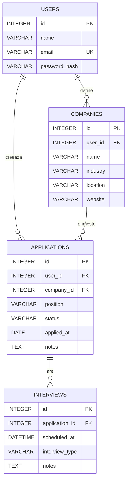

# Diagrama bazei de date

Schema reflectă clasele din `models.py` în etapa 6.

## Explicația relațiilor

- **Users 1:N Companies:** un utilizator gestionează mai multe companii, fiecare companie aparține unui cont.
- **Users 1:N Applications:** un utilizator poate avea mai multe candidaturi; fiecare candidatură aparține unui utilizator.
- **Companies 1:N Applications:** aceeași companie poate avea mai multe candidaturi (poziții diferite).
- **Applications 1:N Interviews:** o candidatură poate avea mai multe interviuri programate; un interviu aparține unei singure candidaturi.

## Chei și constrângeri

- Toate tabelele au `id` drept cheie primară.
- `users.email` este unic.
- Cheile străine sunt `companies.user_id`, `applications.user_id`, `applications.company_id`, `interviews.application_id`.
- Câmpurile obligatorii sunt marcate prin `nullable=False` în `models.py`; statutul și tipul interviului au valori implicite.
- Relația `Application.interviews` folosește `cascade="all, delete-orphan"` în ORM; acesta este un comportament ORM, nu o afirmație despre `ON DELETE CASCADE` la nivel SQLite.
## Explicarea relațiilor dintre tabele

Baza de date a aplicației JobTracker este relațională și utilizează SQLite împreună cu SQLAlchemy.

### 1. Users (Utilizatori)

Tabelul `users` stochează informațiile necesare identificării și autentificării utilizatorilor.

Fiecare utilizator poate avea mai multe candidaturi și companii asociate.

### 2. Companies (Companii)

Tabelul `companies` conține informații despre companiile la care utilizatorii aplică.

O companie poate fi asociată mai multor candidaturi, iar fiecare candidatură face referire la o anumită companie.

### 3. Applications (Candidaturi)

Tabelul `applications` stochează informații despre poziția pentru care s-a aplicat, data candidaturii, statusul recrutării și eventualele observații.

Fiecare candidatură aparține unui utilizator și unei companii.

### 4. Interviews (Interviuri)

Tabelul `interviews` conține informațiile despre interviurile programate, inclusiv data, ora, tipul interviului și observațiile asociate.

Fiecare interviu este asociat unei candidaturi.

## Relații între tabele

- **Users → Applications:** relație de tip unu-la-mulți (1:N).
- **Users → Companies:** relație de tip unu-la-mulți (1:N).
- **Companies → Applications:** relație de tip unu-la-mulți (1:N).
- **Applications → Interviews:** relație de tip unu-la-mulți (1:N).

Aceste relații asigură organizarea coerentă a informațiilor și permit interogarea eficientă a bazei de date.

## Integritatea datelor

Aplicația utilizează chei primare pentru identificarea unică a înregistrărilor și chei externe pentru stabilirea relațiilor dintre tabele.

Ștergerea unei companii asociate unor candidaturi este blocată pentru a preveni pierderea accidentală a informațiilor.

Accesul la date este restricționat în funcție de utilizatorul autentificat.