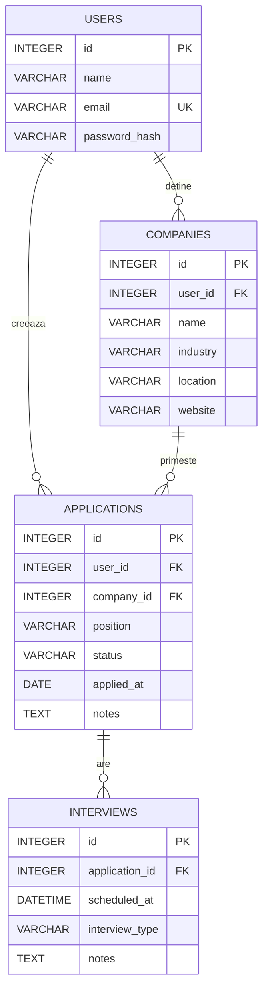

# Diagrama bazei de date

Schema reflectă clasele din `models.py` în etapa 6.

## Explicația relațiilor

- **Users 1:N Companies:** un utilizator gestionează mai multe companii, fiecare companie aparține unui cont.
- **Users 1:N Applications:** un utilizator poate avea mai multe candidaturi; fiecare candidatură aparține unui utilizator.
- **Companies 1:N Applications:** aceeași companie poate avea mai multe candidaturi (poziții diferite).
- **Applications 1:N Interviews:** o candidatură poate avea mai multe interviuri programate; un interviu aparține unei singure candidaturi.

## Chei și constrângeri

- Toate tabelele au `id` drept cheie primară.
- `users.email` este unic.
- Cheile străine sunt `companies.user_id`, `applications.user_id`, `applications.company_id`, `interviews.application_id`.
- Câmpurile obligatorii sunt marcate prin `nullable=False` în `models.py`; statutul și tipul interviului au valori implicite.
- Relația `Application.interviews` folosește `cascade="all, delete-orphan"` în ORM; acesta este un comportament ORM, nu o afirmație despre `ON DELETE CASCADE` la nivel SQLite.
